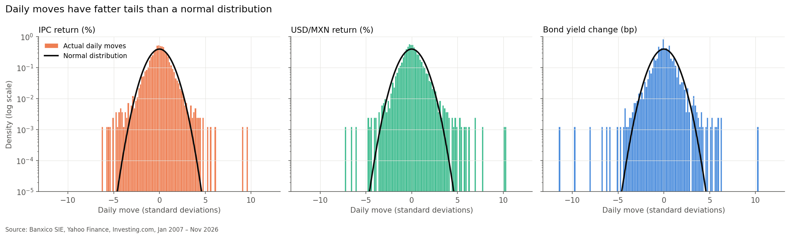
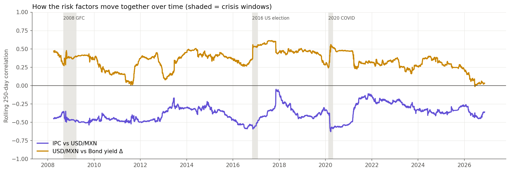
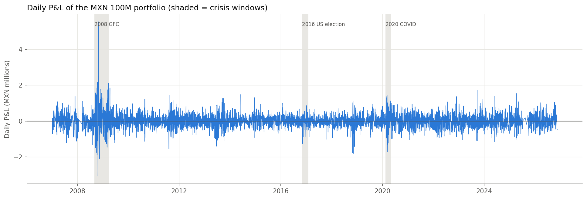
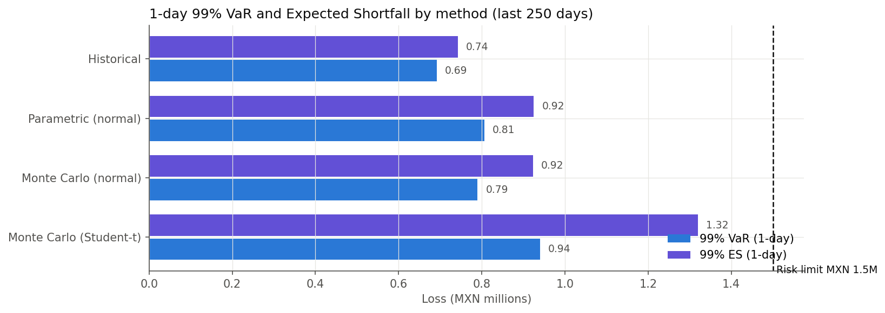
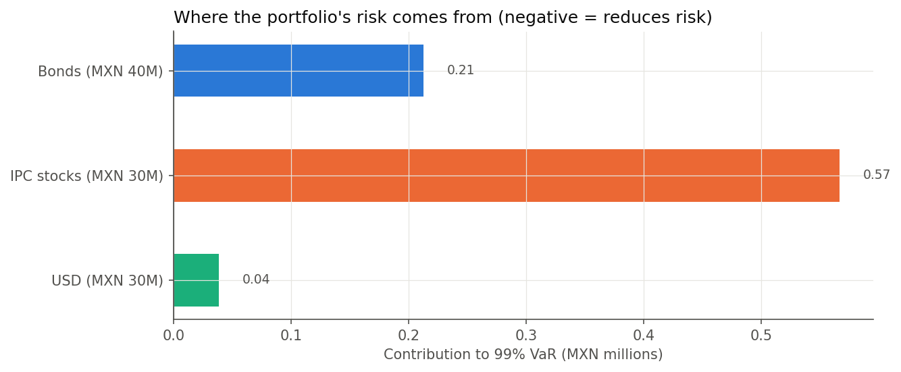
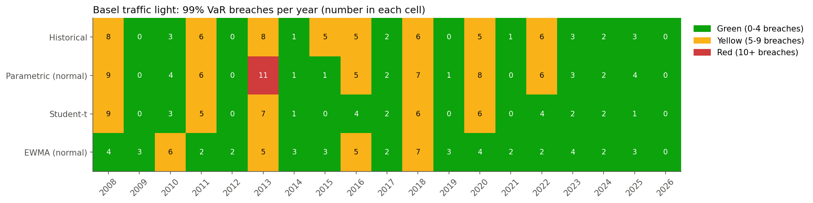
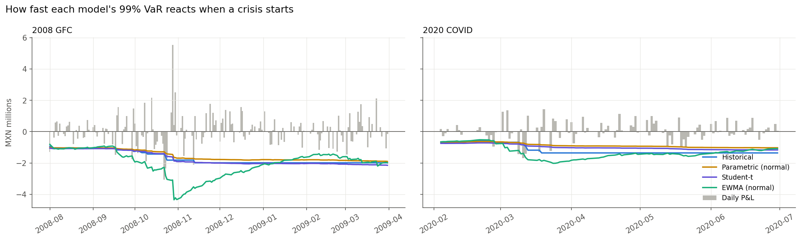
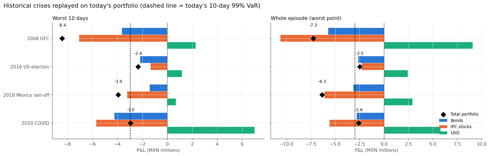
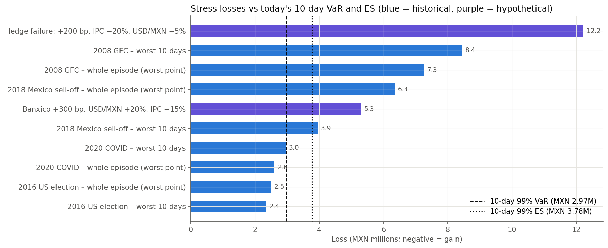
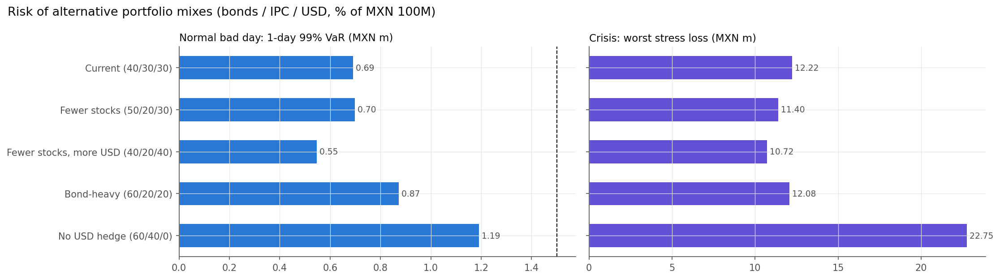

# Value at Risk and Stress Testing for a Mexican Multi-Asset Portfolio

End-to-end market risk analysis of a MXN 100M portfolio of Mexican government bonds, Mexican stocks and US dollars, using 20 years of daily market data (January 2007 – November 2026).

In this project, I collected and validated market data from three sources, then measured the portfolio's risk to answer business questions about how its markets behave, how much it could lose on a normal bad day, whether the risk models can be trusted, how much it could lose in a crisis, and whether a different mix would be safer.


**Tools:** Python (pandas, NumPy, SciPy, Matplotlib, yfinance, requests) and SQL (SQLite) in Google Colab

**Python Notebook:** [Click Here](./VaR_Stress_Testing.ipynb)

---

## Contents

- [Value at Risk and Stress Testing for a Mexican Multi-Asset Portfolio](#value-at-risk-and-stress-testing-for-a-mexican-multi-asset-portfolio)
  - [Contents](#contents)
  - [Business questions](#business-questions)
  - [Executive summary](#executive-summary)
  - [Dataset](#dataset)
  - [Data cleaning and validation](#data-cleaning-and-validation)
    - [Issues found and how they were handled](#issues-found-and-how-they-were-handled)
    - [Data quality findings](#data-quality-findings)
  - [Key definitions](#key-definitions)
  - [Methodology](#methodology)
  - [Findings](#findings)
    - [1. Risk factor behaviour](#1-risk-factor-behaviour)
    - [2. Value at Risk and Expected Shortfall](#2-value-at-risk-and-expected-shortfall)
    - [3. Backtesting](#3-backtesting)
    - [4. Stress testing](#4-stress-testing)
    - [5. Portfolio mix](#5-portfolio-mix)
  - [Recommendations](#recommendations)
  - [Limitations](#limitations)
  - [Repository structure](#repository-structure)

---

## Business questions

The portfolio holds **MXN 40M in 10-year Mexican government bonds (M Bonos), MXN 30M in Mexican stocks (IPC index) and MXN 30M in US dollars**, a mix typical of a Mexican bank treasury, pension fund or insurer.

1. **Risk factors:** How do Mexican stocks, the peso and bond yields behave, and how do they move together in calm and crisis markets?
2. **Normal bad day:** How much could the portfolio lose on a normal bad day, and which position drives the risk?
3. **Model reliability:** Would the risk models (VaR) have worked from 2008 to 2026?
4. **Crises:** How much would today's portfolio lose if a past or plausible crisis happened now?
5. **Portfolio mix:** Would a different allocation reduce risk?

---


## Executive summary

| Area | Headline |
|---|---|
| **Risk factors** | All three markets have **fat tails** (extreme days 5–6× more often than a normal distribution predicts) and **move together more strongly in crises**. Holding the three assets together **halves** daily risk. |
| **Normal bad day** | 1-day 99% VaR is **MXN 0.69M–0.94M**, well within the MXN 1.5M daily limit. **Stocks drive 69% of the risk** with 30% of the capital. |
| **Model reliability** | All models work at 95%, but **none fully passes at 99%**. The normal-distribution model is the weakest (**70 breaches vs 46 expected**, one Basel red-zone year). |
| **Crises** | A repeat of **2008 would cost MXN 8.44M in two weeks** (2.8× 10-day VaR). If stocks and bonds fall while the peso strengthens, the loss reaches **MXN 12.22M (12.2% of the portfolio)**. |
| **Portfolio mix** | Moving 10% from stocks to US dollars (**40/20/40**) lowers risk on every measure; removing the USD position would **almost double** the worst crisis loss. |

**Top priorities:** rebalance to 40/20/40, replace the normal-distribution VaR with a fat-tailed, fast-reacting model, and add a stress loss limit alongside the daily VaR limit.

---

## Dataset

Four daily market series, stored in SQLite and joined on date:

| Series | Source | Rows | Contents |
|---|---|---|---|
| `usdmxn` | Banxico SIE REST API (series SF43718) | 4,998 | USD/MXN FIX exchange rate (pesos per US dollar) |
| `cetes28` | Banxico SIE REST API (series SF43936) | 1,037 | 28-day Treasury bill rate (weekly auction), used for scenario context only |
| `ipc` | Yahoo Finance (`^MXX`, via `yfinance`) | 4,984 | S&P/BMV IPC stock index level |
| `mbono10y` | Investing.com (2 CSV files) | 5,458 | 10-year M Bono yield (% per year) |

**Final dataset:** 4,901 trading days and 4,850 clean daily changes, covering the 2008 GFC, the 2016 US election, the 2018 Mexico sell-off and 2020 COVID.

---

## Data cleaning and validation

### Issues found and how they were handled

| Series | Issue | Rows | Action |
|---|---|---|---|
| Bond yield | Investing.com download limit (first file stopped at 18 Dec 2024) | 5,000 | Downloaded a second file to complete the history to Nov 2026 |
| Bond yield | Saturday/Sunday rows that were separate quotes, not copies of Friday (only 1.5% matched) | 478 | Ran a date-alignment test on the 111 affected months: dates as downloaded line up with the peso (correlation 0.387 vs 0.040 if shifted), so the weekend rows were removed |
| Bond yield | Weekdays with a yield but no FX rate (Mexican bank holidays) | 65 | Excluded |
| Bond yield | Bad price on 6 Sep 2013 (6.57% → 5.97% → 6.23% while stocks were calm) | 1 | Identified by manual review and replaced with the average of the neighbouring days (6.40%) |
| Bond yield | Spike on 14 Nov 2016 flagged by the rule-based screen | 1 | Kept as a real move, as it falls inside the 2016 US election crisis |
| IPC + bond yield | Missing business days, so some "daily" changes covered several days | 97 days (14 IPC, 83 bond) | The 50 affected changes were flagged and excluded from the daily analysis rather than filled |
| CETES 28 | Weekly auction rate | 1,037 | Carried forward between auctions |

### Data quality findings

- **All long gaps come from the bond data**, including a 30-business-day gap (18 Jan – 3 Mar 2008) and patchy coverage in Jul–Sep 2025. Without the fix, six weeks of movement would have appeared as a single +10.5% "daily" stock move on 3 Mar 2008.
- **Extreme moves were kept unless there was strong evidence of an error**, because removing real crash days would understate risk. Only one price was corrected.
- **Timing check:** the USD/MXN FIX is set at midday, while stocks and bonds are end-of-day closes. A lead-lag test showed the series are aligned (bond vs USD/MXN: 0.363 same day vs 0.074 or less at ±1 day), with a small lag between stocks and the FX rate (−0.158 with the next day's FIX).

---

## Key definitions

| Term | Meaning |
|---|---|
| **Value at Risk (VaR)** | The loss that should only be exceeded on a small share of days. *1-day 99% VaR = MXN 1M* means the portfolio should not lose more than MXN 1M on 99 days out of 100 |
| **Expected Shortfall (ES)** | The **average** loss on the days worse than VaR, i.e., how bad the bad days are |
| **Breach** | A day when the actual loss was bigger than the VaR forecast |
| **Kupiec test** | Checks whether the number of breaches matches the expected rate (1% for 99% VaR) |
| **Christoffersen test** | Checks whether breaches cluster together, a sign the model reacts too slowly |
| **Basel traffic light** | Regulatory score for 99% VaR based on breaches per year: 0–4 green, 5–9 yellow, 10+ red |
| **EWMA** | Volatility that gives more weight to recent days (RiskMetrics, λ = 0.94), so it reacts quickly when markets turn |
| **Student-t** | A distribution with fat tails, allowing for more extreme days than a normal bell curve |
| **Duration / convexity** | How much a bond's price changes when its yield moves |
| **Basis point (bp)** | 0.01 percentage point (a yield rising from 9.30% to 9.40% = +10 bp) |
| **Stress test** | The loss if a past or plausible crisis happened to today's portfolio |
| **Reverse stress test** | The size of shock needed to cause a chosen loss (here MXN 10M) |

---

## Methodology

- **Data pipeline:** pulled the FX and CETES series from the Banxico REST API (token stored as a Colab secret), the IPC from `yfinance` and the bond yield from CSV files; stored them in one long table in SQLite and pivoted them to one row per date with SQL.
- **Data validation:** weekend-row check with a date-alignment test, holiday check, lead-lag timing test, rule-based bad-price screen with manual review, and a business-day check to exclude changes spanning missing days.
- **Portfolio P&L:** daily profit/loss in MXN for each position, with the bond repriced through duration and convexity (recalculated each day from that day's yield).
- **Fat tails and correlations:** kurtosis, Jarque-Bera normality test, days beyond 3 standard deviations, and correlations in calm vs crisis periods (full period and rolling 250-day).
- **VaR and ES:** historical, parametric (variance-covariance) and Monte Carlo (10,000 simulations with Cholesky decomposition, normal and Student-t versions), at 95% and 99%, over 1 and 10 days. Risk contribution by position used component VaR.
- **Backtesting:** rolling 250-day VaR forecasts for every day from Apr 2008 to Nov 2026 (no look-ahead), tested with Kupiec and Christoffersen tests and the Basel traffic light. An EWMA model was added to test a faster-reacting approach.
- **Stress testing:** four historical crises replayed on today's portfolio (worst day, worst 10 days and whole episode), two hypothetical scenarios, and a reverse stress test. Bonds were fully repriced for large yield moves.
- **Portfolio mix:** VaR, ES and stress losses recalculated for five alternative allocations.

Significance level: p < 0.05.

---

## Findings

### 1. Risk factor behaviour



- **All three markets have fat tails:** excess kurtosis of 6.9 (IPC), 9.9 (USD/MXN) and 12.8 (bond yield). Days beyond 3 standard deviations: 71, 70 and 77, against about 13 expected under a normal distribution. Normality is rejected for all three (Jarque-Bera p < 0.001).
- **The largest moves all fall on known stress events,** mostly October 2008 (e.g., IPC +11.0% on 13 Oct 2008) and the 2016 US election (USD/MXN +7.65% on 9 Nov 2016).



| Pair | Calm markets | Crises |
|---|---|---|
| IPC vs USD/MXN | −0.35 | **−0.51** |
| IPC vs bond yield | −0.17 | **−0.44** |
| USD/MXN vs bond yield | 0.30 | **0.51** |

- **Markets move together more strongly in crises:** stocks fall on the days bond yields rise, so the **bond and stock positions lose together** when it matters most.
- **The peso acts as a natural hedge:** it weakens when stocks fall, so the USD position gains. The link between the peso and bond yields has weakened since 2025 (rolling correlation near 0).
- **Bond sensitivity:** at today's 9.30% yield, a 1 percentage-point rise cuts the bond's value by about 6.1% (modified duration 6.42).



- **Holding the three assets together halves daily risk** (MXN 0.391M vs MXN 0.782M if held separately). The USD position gained on **7 of the 10 worst days**.
- The worst day was **22 Oct 2008 (−MXN 3.07M)**. Three of the 10 worst days were outside the main crises: 8 Aug 2011 and 29 Oct / 8 Nov 2018 (a domestic Mexican sell-off).

### 2. Value at Risk and Expected Shortfall



| Method (last 250 days) | 1-day 99% VaR | 1-day 99% ES | 10-day 99% VaR (√10) |
|---|---|---|---|
| Historical | MXN 0.69M | MXN 0.74M | MXN 2.19M |
| Parametric (normal) | MXN 0.81M | MXN 0.93M | MXN 2.55M |
| Monte Carlo (normal) | MXN 0.79M | MXN 0.92M | MXN 2.50M |
| Monte Carlo (Student-t) | **MXN 0.94M** | **MXN 1.32M** | **MXN 2.97M** |

- **All methods are well within the MXN 1.5M limit** (46%–63% of it).
- **The past year was calmer than usual:** historical 99% VaR is MXN 0.69M for the last 250 days vs MXN 0.96M over 2007–2026.
- **The fat-tailed Student-t model is the most realistic:** its VaR and ES (MXN 0.94M and MXN 1.32M) are close to the full-history historical figures (MXN 0.96M and MXN 1.33M).
- **The √10 shortcut is not always safe:** it understated the past year's 10-day 99% VaR by about a third (MXN 2.19M vs MXN 2.91M actual).



- **Stocks drive the risk:** the IPC position contributes **69%** of 99% VaR with 30% of the capital; bonds 26% and US dollars only 5%.

### 3. Backtesting

4,600 daily forecasts (Apr 2008 – Nov 2026), 46 breaches expected at 99%:

| Method | 99% breaches | Kupiec p | Christoffersen p | Green / yellow / red years | Average 99% VaR |
|---|---|---|---|---|---|
| Student-t | **52** | **0.384** | 0.023 | 14 / 5 / 0 | MXN 0.97M |
| EWMA (normal) | 62 | 0.024 | **0.193** | **15 / 4 / 0** | **MXN 0.83M** |
| Historical | 64 | 0.012 | 0.304 | 11 / 8 / 0 | MXN 0.92M |
| Parametric (normal) | 70 | 0.001 | 0.117 | 12 / 6 / **1** | MXN 0.86M |

- **All methods pass at 95%, but none passes both tests at 99%.**
- **The normal-distribution model performs worst:** 52% more breaches than expected and the only Basel red-zone year (11 breaches in 2013).
- **Student-t gets the number of breaches right but reacts slowly** (breaches cluster); **EWMA reacts fastest** (no back-to-back breaches) but has slightly too many breaches.





- **Window-based models warn late and stay high too long:** in 2008, EWMA rose to about MXN 2.4M by mid-October while the others stayed around MXN 1.0–1.4M. After the crisis, the window-based models kept VaR above the MXN 1.5M limit on 205–213 days in 2009, vs 79 for EWMA.
- **Only EWMA flagged the 2018 and 2020 stress periods** by rising above the limit.

### 4. Stress testing



| Scenario | Loss | × 10-day 99% VaR | % of portfolio |
|---|---|---|---|
| **Hedge failure** (yields +200 bp, IPC −20%, USD/MXN −5%) | **MXN 12.22M** | **4.11×** | 12.22% |
| 2008 GFC, worst 10 days | MXN 8.44M | 2.84× | 8.44% |
| 2018 Mexico sell-off, whole episode | MXN 6.35M | 2.14× | 6.35% |
| Banxico +300 bp, USD/MXN +20%, IPC −15% | MXN 5.30M | 1.78× | 5.30% |
| 2020 COVID, worst 10 days | MXN 2.96M | 0.99× | 2.96% |
| 2016 US election, whole episode | MXN 2.50M | 0.84× | 2.50% |

- **Crisis losses are up to four times larger than VaR:** 6 of 10 multi-day scenarios exceed both 10-day VaR and ES, and every crisis's worst day exceeds 1-day VaR.
- **The peso protects in global crises, not local ones:** the USD position offset MXN 6.99M in COVID's worst two weeks, but only MXN 2.90M in the 2018 domestic sell-off, where the loss also did not recover within the period.
- **The biggest weakness is a hedge failure:** with smaller rate and peso moves than the Banxico scenario, it loses more than twice as much, because all three positions lose at once.



- **Reverse stress test (MXN 10M loss):** it would take a crisis only **19% worse than 2008's worst two weeks**, or just **81%** of the hedge-failure scenario. On their own, yields would need to rise 472 bp or stocks fall 33%.

### 5. Portfolio mix



| Mix (bonds / IPC / USD) | 1-day 99% VaR | 2008 worst 10 days | Banxico scenario | Hedge failure | Worst stress loss |
|---|---|---|---|---|---|
| Current (40/30/30) | MXN 0.69M | MXN 8.44M | MXN 5.30M | MXN 12.22M | MXN 12.22M |
| Fewer stocks (50/20/30) | MXN 0.70M | MXN 6.99M | MXN 5.50M | MXN 11.40M | MXN 11.40M |
| **Fewer stocks, more USD (40/20/40)** | **MXN 0.55M** | **MXN 5.33M** | **MXN 1.80M** | **MXN 10.72M** | **MXN 10.72M** |
| Bond-heavy (60/20/20) | MXN 0.87M | MXN 8.66M | MXN 9.20M | MXN 12.08M | MXN 12.08M |
| No USD hedge (60/40/0) | MXN 1.19M | MXN 14.88M | MXN 16.20M | MXN 15.08M | MXN 22.75M |

- **40/20/40 is the safest mix on every measure:** VaR falls by 20% and the 2008 stress loss from MXN 8.44M to MXN 5.33M.
- **Cutting stocks only helps if the money doesn't go into more bonds:** the bond-heavy mix is riskier than today's.
- **The USD position is essential:** without it, the worst stress loss almost doubles (MXN 22.75M).
- **No mix removes the hedge-failure risk:** the safest mix still loses MXN 10.72M in that scenario.

---

## Recommendations

In priority order:

1. **Rebalance from 40/30/30 to 40/20/40** (move 10% from stocks to US dollars). It lowers VaR, ES and every crisis loss tested. Review the impact on expected returns first, as this analysis measures risk only.
2. **Replace the normal-distribution VaR with a fat-tailed, fast-reacting model.** Combine EWMA volatility with a Student-t distribution for limits and capital; until then, use EWMA as the daily VaR and Student-t as a conservative check.
3. **Add a stress loss limit next to the daily VaR limit,** e.g., "worst stress scenario ≤ 10% of the portfolio", reviewed monthly. Daily VaR (below MXN 1M) does not show crisis losses of up to MXN 12.22M.
4. **Protect against a hedge failure or a domestic crisis.**
   - *Risk team:* run the hedge-failure and 2018-style scenarios every month.
   - *Portfolio managers:* consider direct hedges for stocks and bonds (e.g., IPC futures, interest-rate swaps) instead of relying only on the peso.
5. **Use EWMA VaR as an early-warning signal:** cut positions when it rises above the MXN 1.5M limit, before losses build up over weeks as in 2018.

---

## Limitations

- **The bond is a generic 10-year par bond** based on a single free data source (Investing.com), which had gaps (e.g., Jan–Mar 2008, Jul–Sep 2025) and one bad price corrected by judgement.
- **The portfolio is hypothetical,** held at fixed weights throughout; stress losses assume no trading during a crisis, so they are worst-case figures.
- **Hypothetical scenarios and the MXN 1.5M limit are assumptions** for illustration, not forecasts or regulatory requirements.
- **The Monte Carlo methods were backtested through their formula equivalents,** and the Basel traffic light was applied by calendar year rather than on a rolling basis.
- **Portfolio mixes are compared on risk only,** not on expected return.

---

## Repository structure

```
VaR-Stress-Testing/
├── README.md
├── VaR_Stress_Testing.ipynb
├── data/
│   ├── mbono10y.csv
│   └── mbono10y_2.csv
└── images/
    ├── fat_tails_distribution.png
    ├── rolling_correlation.png
    ├── daily_pnl.png
    ├── var_es_by_method.png
    ├── risk_contribution.png
    ├── basel_traffic_light.png
    ├── var_crisis_reaction.png
    ├── historical_stress_by_leg.png
    ├── stress_vs_var.png
    └── portfolio_mix.png
```
